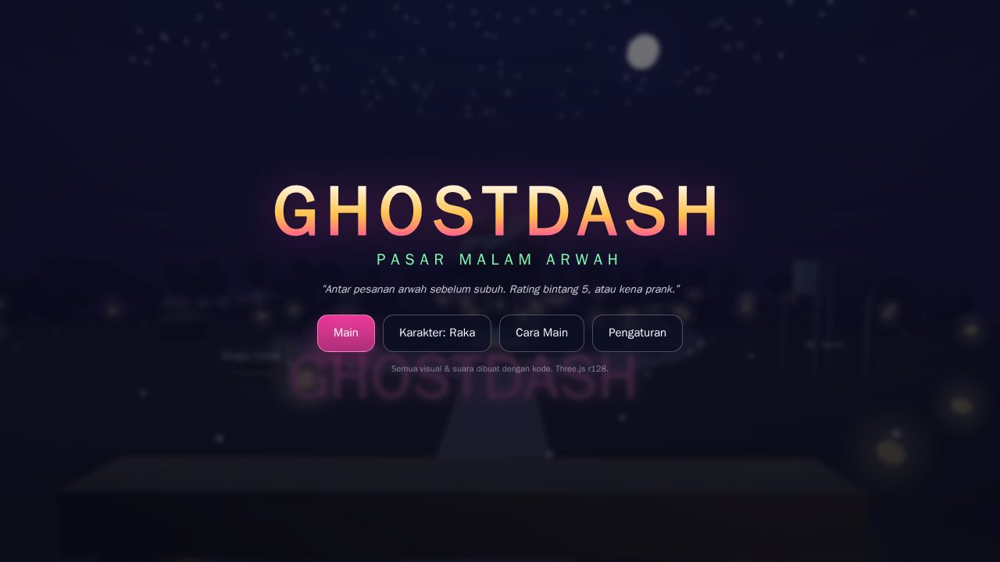
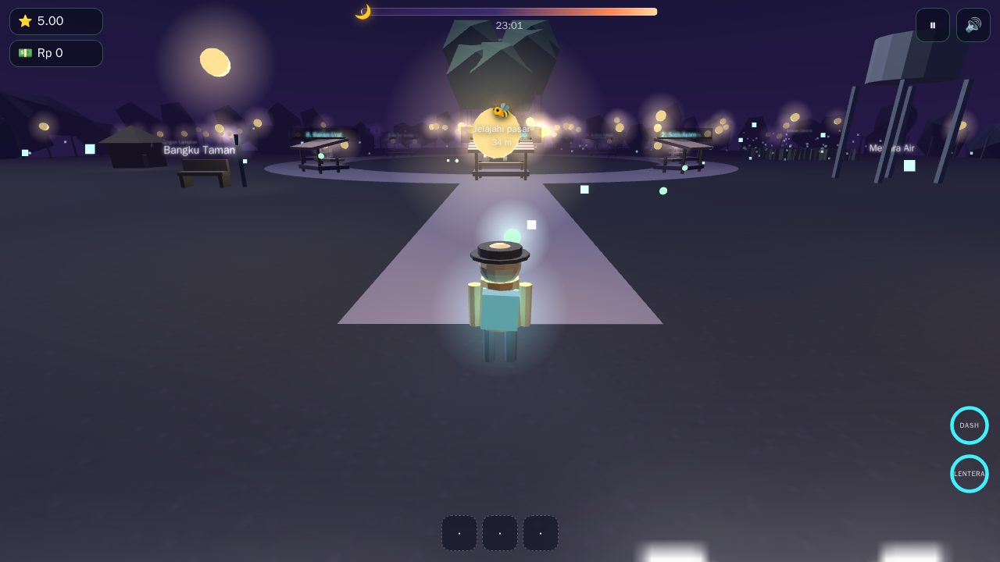
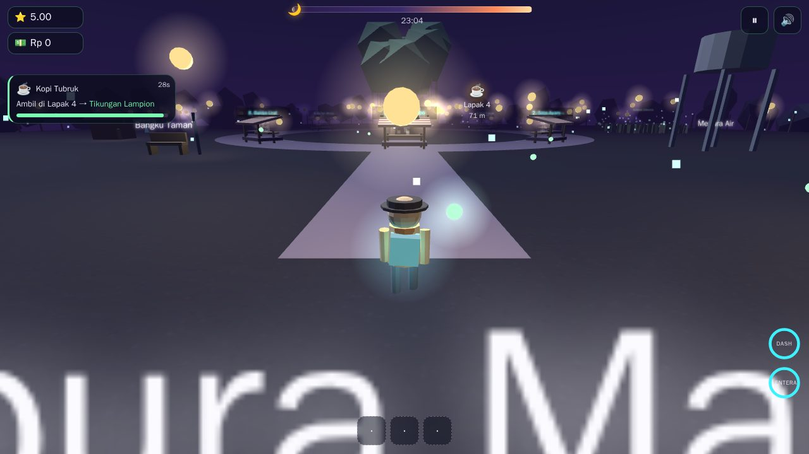

<div align="center">

# GHOSTDASH
### Pasar Malam Arwah

**"Antar pesanan arwah sebelum subuh. Rating bintang 5, atau kena prank."**

Game 3D open-world mini bertema pasar malam Indonesia. Kamu kurir baru di aplikasi
antar bernama **GHOSTDASH** — ambil pesanan dari lapak, antar ke pelanggan gaib,
kejar setoran sebelum matahari terbit.



</div>

---

## Apa ini?

Game 3D *delivery arcade* bergaya **cozy-spooky** — seram yang lucu, bukan horor.
Satu sesi 3–5 menit per malam. Semua visual dan suara dibuat **prosedural** dari kode:
tidak ada satu pun file gambar, model 3D, font, atau audio eksternal.

**Cukup buka `index.html` di browser.** Tanpa server, tanpa build tool, tanpa install.

---

## Tema

**Pasar Malam Arwah** — pasar yang hanya muncul saat malam Jumat Kliwon, di ujung desa.
Penghuninya arwah yang tidak bisa meninggalkan tempat menunggu, tapi kelaparan jajan.
Karena itu mereka pesan lewat aplikasi antar.

Nuansa yang dibangun:

- **Hangat dan misterius** — lampion gantung, bohlam, uap makanan, kunang-kunang, jangkrik.
- **Humor ringan** — arwah cerewet soal pesanan, ulasan bintang satu yang dramatis.
- **Waktu yang bergerak** — langit berubah dari ungu gelap ke jingga fajar selama permainan.
  Ini sekaligus **timer visual**: begitu matahari terbit, pasar menghilang.

<br>



---

## Misinya apa?

Kamu **kurir baru** yang butuh duit (dan konten). Aturannya sederhana:

1. **Pesanan masuk berkala.** Notifikasi muncul dengan kartu pesanan: item apa, ambil di
   lapak nomor berapa, antar ke landmark mana, dan berapa detik sisa waktunya.
2. **Ambil item di lapak.** Dekati lapak → tekan **E** / tombol **AKSI**. Tas kapasitas **3 item**.
3. **Antar ke pelanggan.** Cari pelanggan gaib (ada marker 3D + panah tepi layar kalau di luar
   pandangan), tekan **E** untuk mengantar.
4. **Jangan sampai hangus.** Timer habis → rating turun. Bawa item yang salah → rating turun.

**Menang:** bertahan sampai **Subuh**. Dapat grade **S / A / B / C**, total penghasilan,
pesanan sukses, combo terbaik, kunang-kunang terkumpul.

**Kalah:** rating jatuh di bawah **2.0** → akunmu **disuspend** 💀 dan diusir dari pasar.

### Mekanik "Kasih Asal"

Tombol kedua (**Q** / **KASIH ASAL**): kasih item apa saja dari tas ke pelanggan, walau
tidak cocok.

- **35%** sukses jadi "treat kecil" — reward 50%, combo tidak putus.
- **65%** gagal → **TRICK**: kena prank, combo putus, rating turun.

Ini inti *trick-or-treat*-nya: judi kecil yang bikin tiap antar terasa menegangkan.

<br>



---

## Item & lapak

Ada **8 lapak** bernomor melingkar di pusat pasar, masing-masing dengan cincin cahaya di
tanah yang menyala saat ada pesanan cocok.

| Item | Ikon | Lapak |
|---|---|---|
| Es Teh Jumbo | 🧋 | 1, 6 |
| Sate Ayam | 🍢 | 2, 7 |
| Martabak Manis | 🥞 | 3 |
| Kopi Tubruk | ☕ | 4 |
| Bakso Urat | 🍜 | 5, 8 |

**Pelanggan:** Bocil Gaib (kecil, tidak sabar, tip kecil) dan Om Gembul (besar, sabar,
tip besar).

**12 landmark** tujuan antar: Gapura Masuk, Pohon Beringin, Panggung Wayang, Pos Ronda,
Jembatan Bambu, Sawah Cahaya, Gang Gelap, Kolam Teratai, Bangku Taman, Menara Air,
Warung Pojok, Tikungan Lampion.

---

## Kontrol

| Aksi | Desktop | Mobile |
|---|---|---|
| Jalan | **WASD** / panah | Joystick kiri |
| Lari | **Shift** | tombol **LARI** |
| Kamera | mouse (pointer lock / drag) | geser sisi kanan layar |
| Zoom | scroll | — |
| Aksi (ambil / antar) | **E** | tombol **AKSI** |
| Kasih Asal | **Q** | tombol **KASIH ASAL** |
| Dash | **Spasi** | tombol **DASH** |
| Lentera | **F** | tombol **LENTERA** *(belum berfungsi)* |
| Jeda | **P** / **Esc** | tombol ⏸ |
| Mute | **M** | tombol 🔊 |

**Kamera mengikuti arah jalan secara halus.** Kalau kamu belok, kamera menyusul dengan
transisi lembut — tapi kamu tetap bisa mengarahkannya manual kapan saja. Ada `dead-zone`
supaya strafe kecil tidak bikin kamera melayang, dan jeda 0,7 detik setelah kamu geser
kamera manual supaya kamera tidak langsung "merampas" kendali.

Mobile wajib **landscape** — portrait menampilkan layar "putar perangkatmu".

---

## Fitur

- Dunia 3D melingkar radius **70 unit**, kamera orbit **360°**, kabut malam + batas natural.
- **Langit dinamis** malam → fajar sebagai timer visual (180s / 240s / 300s per malam).
- **3 malam + mode Endless**, kesulitan bertingkat.
- **Rating, tip, combo (maks x5), grade S/A/B/C** dengan rumus yang jelas.
- **40 kunang-kunang kolektibel** (+10 skor tiap butir, +2 detik ke pesanan tertua).
- **4 jenis prank** saat Kasih Asal gagal: kontrol kebalik, tas bocor, layar miring, jalan lengket
  (ada immunity 15 detik supaya tidak menumpuk).
- Kompas **Kunang** (pendamping kunang-kunang) yang menunjuk tujuan.
- **3 pencapaian** (Pemburu Kunang, Bintang Lima Beneran, Subuh Tanpa Lecet).
- Tutorial interaktif 3 langkah (sekali saja).
- Kucing hitam dekor yang menoleh ke arahmu.
- Opsi **Kurangi Gerakan** untuk mematikan goyangan kamera.
- Debug mode `?debug=1` (FPS, draw call, triangle, posisi, progress).

---

## Teknis

| Aspek | Nilai |
|---|---|
| Dependensi eksternal | **1** — Three.js r128 dari CDN (versi dikunci) |
| Aset eksternal lain | **0** — semua geometri & tekstur prosedural, audio pakai Web Audio API |
| Server | Tidak perlu — buka `index.html` langsung |
| File | `index.html`, `style.css`, `game.js` |
| Struktur | `CONFIG → Utils → Input → Audio → Scene → World → Entities → Systems → UI → Save → Loop` |
| Optimasi | `InstancedMesh` untuk objek berulang, spatial hash untuk collider |
| Kolisi | Lingkaran + AABB dengan sliding |
| Uji | `node controls-check.js` (arah gerak) · `node phase2-check.js` (wiring gameplay) |

### Menjalankan secara lokal

```bash
# Langsung — cukup klik dua kali index.html, atau:
xdg-open index.html

# Lewat server lokal (kalau browser memblokir sesuatu):
python3 -m http.server 8000    # lalu buka http://localhost:8000
```

### Jalankan uji

```bash
node controls-check.js    # 8 asersi arah gerak + kamera follow
node phase2-check.js      # wiring sistem pesanan & delivery
```

---

## Struktur repo

```
ghostdash/
├── index.html            # markup + HUD + overlay
├── style.css             # seluruh tampilan
├── game.js               # seluruh logika game (~2100 baris)
├── controls-check.js     # uji arah gerak & kamera
├── phase2-check.js       # uji wiring gameplay
├── PROMPT.md             # spesifikasi lengkap game (sumber desain)
├── CHECKLIST.md          # status per fase, item mana yang sudah selesai
└── docs/                 # tangkapan layar
```

---

## Status pengerjaan

**FASE 1 (fondasi dunia) dan FASE 2 (gameplay inti) sudah jalan.** FASE 3 (Wisp Usil,
Mbak Lampion, Eyang Wayang, hujan, stamina) dan FASE 4 (musik gamelan, kelelawar, penjual
animasi) belum.

**Catatan jujur:** tombol **LENTERA** dan **DASH** ada di UI, tapi Lentera baru memunculkan
toast "lengkap di Fase 3" — belum berfungsi. Dash sudah jalan tapi belum punya cooldown UI.

Rincian item per item ada di [`CHECKLIST.md`](CHECKLIST.md).

### Yang sudah diverifikasi berjalan

- Arah gerak joystick + WASD di 4 arah (diuji di Chrome headless dengan emulasi mobile
  dan desktop — lihat `controls-check.js`).
- Drag kamera kiri/kanan, zoom, follow kamera saat belok.
- Boot tanpa error konsol, layar judul, HUD, kartu pesanan, marker tujuan.
- Jeda otomatis saat tab tidak aktif, restart tanpa reload.

### Yang BELUM diverifikasi

Satu malam penuh sampai Subuh di desktop dan di HP asli, kalah karena rating < 2.0, dan
semua varian prank — ini butuh main manual, belum sempat diuji. Tombol **LENTERA** juga
belum berfungsi (masih toast placeholder).

---

## Kredit

Dibuat dengan kode. **Nol aset eksternal.** Satu-satunya dependensi: Three.js r128.
